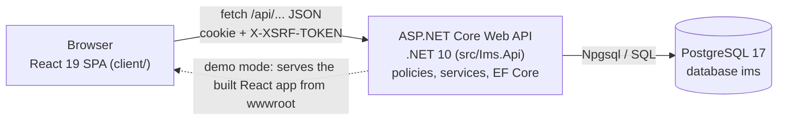

# Inventory Management System (IMS)

A barcode-based inventory system that follows one physical unit from **component tracking → receiving → delivery**.
It has five roles (one per user, enforced on the server), an append-only inventory history, admin-only reversals,
reports, CSV/Excel export, an audit log and a dashboard. This is an industrial-attachment learning/demo project.

**Status: v1.0.0 (Day 6 of 6) - complete and tested.** 114 .NET tests, 39 Vitest tests and 7 Playwright end-to-end specs pass;
the executed test-case sheet is in `docs/testing/`.

## What it does (mapped to the assignment brief)

| Brief | Where it is |
|---|---|
| **Core 1** Auth: register, login, logout, hashed passwords, one role per user | Identity cookie login; 5 roles; self-registration needs Admin activation |
| **Core 2** Admin panel: product, component, receive/delivery point CRUD; users and roles | `/manage/*` (soft delete for used rows) |
| **Core 3** Receive at a receive point | `/ops/receive` |
| **Core 4** Component tracking (a component barcode belongs to one product only) | `/ops/track` |
| **Core 5** Delivery of in-stock units only | `/ops/deliver` |
| **Core 6** Append-only history, status derived | `inventory_transactions` + EF interceptor + database trigger; no status column |
| **Core 7** Admin reversal with reason (receive only if not delivered; delivery returns to its receive point; component detached) | `/history` -> Reverse |
| **Core 8** Reports: stock by receive point, date-range summary with graph, barcode-wise history | `/reports/stock`, `/reports/summary`, `/reports/barcode` |
| **Additional 1** Search, filter, pagination | every list and report |
| **Additional 2** CSV / Excel export | buttons on every list and report |
| **Additional 3** Audit log (changes and logins, old/new values) | `/audit` |
| **Additional 4** Activate / deactivate users, soft delete of used master data | `/manage/users`, `/manage/*` |
| **Additional 5** Client + server validation, clear errors, duplicate-scan warning | zod + server rules; yellow warning vs red error |
| **Additional 6** Dashboard | `/` |
| **Additional 7** Password change, forced logout of deactivated users | user menu; cookie re-checked on every request |

## Architecture



Full diagrams: [process flow](docs/diagrams/process-flow.md) and [ER diagram](docs/diagrams/er-diagram.md) (PNG and PDF next to them).

## Stack and why

| Part | Choice | Why |
|---|---|---|
| Frontend | React 19 + TypeScript + Vite, React Router, TanStack Query, react-hook-form + zod, Bootstrap 5, Chart.js | Components + strict types; Query caches server data; forms validated once in a schema |
| Backend | ASP.NET Core Web API on .NET 10 (controllers) | Typed C#, built-in dependency injection, policies and validation |
| Auth | ASP.NET Core Identity, **cookie** login + antiforgery header | HttpOnly cookie cannot be read by JavaScript; no tokens in `localStorage` |
| Database | PostgreSQL 17 via EF Core 10 + Npgsql (snake_case names) | Real production-style database; schema changes only through migrations |
| Tests | xUnit + `WebApplicationFactory` against a real `ims_test` database; Vitest + Testing Library | Tests exercise the real database, triggers and policies |

One origin: in development Vite (port 5173) forwards `/api` to the API (port 5080), so there is no CORS setup.
For the demo, `npm run build` puts the React app into the API's `wwwroot` and the API serves it.

### Package versions used (resolved 22 Nov 2026)

NuGet: Npgsql.EntityFrameworkCore.PostgreSQL 10.0.3 · EFCore.NamingConventions 10.0.1 ·
Microsoft.AspNetCore.Identity.EntityFrameworkCore 10.0.15 · Microsoft.EntityFrameworkCore.Design 10.0.15 ·
ClosedXML 0.105.1 · Microsoft.AspNetCore.Mvc.Testing 10.0.15 · xunit 2.9.3

npm: react 19.3.1 · vite 8.3.8 · typescript 7.0.2 · react-router 8.5.2 · @tanstack/react-query 5.108.0 ·
react-hook-form 7.92.0 · zod 4.6.7 · @hookform/resolvers 7.0.7 · bootstrap 5.3.9 · chart.js 4.6.1 ·
react-chartjs-2 5.3.1 · vitest 5.1.1 · @testing-library/react 16.3.3

## Prerequisites

- **.NET 10 SDK** (10.0.404 or newer 10.0.x) and the **dotnet-ef** tool: `dotnet tool install --global dotnet-ef`
- **Node.js LTS** (26) with npm
- **PostgreSQL 17** running on `localhost:5432`
- **Git**
- Microsoft Edge (only for the Playwright end-to-end tests and screenshots)

### Database setup

You need a database `ims` and a login role `ims_user` (with CREATEDB, because the tests create `ims_test`).
`docs/planning/scripts/setup-ims-database.ps1` creates both and asks you for a password:
```powershell
powershell -ExecutionPolicy Bypass -File docs/planning/scripts/setup-ims-database.ps1
```
Then store the connection string as a user-secret (next section). The password is never written to a file.

## Setup (first time)

1. **Store the connection string as a user-secret** (never in a file that git tracks). Type your real `ims_user`
   password in place of the placeholder:
   ```powershell
   dotnet user-secrets set "ConnectionStrings:Ims" "Host=localhost;Port=5432;Database=ims;Username=ims_user;Password=<your ims_user password>" --project src/Ims.Api
   ```
2. Create the tables and seed the demo data:
   ```powershell
   dotnet ef database update --project src/Ims.Api
   dotnet run --project src/Ims.Api -- seed
   npm ci --prefix client
   ```
   Seeding is safe to repeat: it never creates duplicates. For a presentation add demo data (25 extra units, reversals,
   an archived item; deterministic): `dotnet run --project src/Ims.Api -- seed --demo-data`.

## Seeded logins (demo-only passwords)

| User name | Role | Employee no. | Password |
|---|---|---|---|
| `admin` | ADMIN | 10001 | `Admin@12345` |
| `tracker` | COMPONENT_TRACKER | 66798 | `Demo@12345` |
| `receiver` | RECEIVE_USER | 58877 | `Demo@12345` |
| `deliverer` | DELIVERY_USER | 54671 | `Demo@12345` |
| `viewer` | REPORT_VIEWER | 20001 | `Demo@12345` |

Seeded sample record (from the assignment brief): unit `2440701AK2057` (Refrigerator) — component tracked
2026-03-27 10:00:00 → received 2026-03-28 10:15:00 → delivered 2026-03-30 11:30:00 (Asia/Dhaka time). Its status
is *Delivered* and `/history` shows all three rows.

Self-registration (`/register`) creates an **inactive Report Viewer** that cannot sign in until an Admin activates it.

## Run

**Development** (two terminals; open <http://localhost:5173>):
```powershell
dotnet run --project src/Ims.Api --launch-profile http
npm run dev --prefix client
```

**Demo** (one server; open <http://localhost:5080>):
```powershell
npm run build --prefix client
dotnet run --project src/Ims.Api --launch-profile http
```
Use the `http` profile: the HTTPS development certificate is not trusted on this machine.
Restart the API after rebuilding the client.

## Tests

```powershell
dotnet test                         # 114 tests against the real ims_test database (dropped and re-created each run)
npm test --prefix client            # 39 Vitest tests (components and logic)
npm run e2e --prefix client         # 7 Playwright specs in demo mode: smoke flow, 5-role UI matrix, screenshots
```
The .NET tests reuse the user-secret's host and password but always switch the database name to `ims_test`.
The Playwright specs need **demo mode running** on <http://localhost:5080> (build the client, start the API, seed first) and use the
installed Microsoft Edge. `npm run diagrams --prefix client` re-renders the diagram images (needs internet once, for Mermaid).
The executed test-case sheet is `docs/testing/test-cases.xlsx` (rebuild: `dotnet run --project tools/Ims.DocTools -- test-sheet`).

## Reset the database

```powershell
dotnet ef database drop --force --project src/Ims.Api
dotnet ef database update --project src/Ims.Api
dotnet run --project src/Ims.Api -- seed
```

## Admin panel

Sign in as `admin`. The **Admin** menu has Products, Components, Points and Users; every role has **Change password** in the
user menu (top right).

- **Master data** (`/manage/products`, `/manage/components`, `/manage/points`): search, a status filter (Active / Archived / All),
  a type filter for points, paging, create, edit, delete and restore. Names are unique ignoring upper/lower case and
  surrounding spaces (points: per type). **Delete** asks for confirmation: if the row is used by a unit or history it is
  *archived* (hidden from dropdowns, still shown in history, restorable); otherwise it is removed for good.
- **Users** (`/manage/users`): search by user name, name or employee number; filters for role, active/inactive and a
  **Pending registration** chip (self-registered accounts that are inactive and never signed in); create with one role,
  edit names / employee number / role, activate / deactivate, reset password. Users are never deleted.
  You cannot deactivate yourself, and the last active Admin cannot be deactivated or demoted.
- **Forced logout:** deactivating a user (or resetting their password) invalidates their sign-in cookie. Their next click or API
  call returns 401 and the app shows the login page with "Your session has ended. Please sign in again."
- **Lists keep their state in the URL** (`?q=&status=&page=`), so Back, refresh and copied links keep the filters.
- **Dropdown feed:** `GET /api/<products|components|points>/options` returns non-archived rows only (also for the operational roles).
- **Export buttons** (CSV and Excel) are on every list, see "Reversals, reports & export" below.

## Operations

The life of one unit: **track components -> receive -> deliver**. Sign in as `tracker`, `receiver` and `deliverer` (see the seeded
logins). Each screen starts with a barcode box that already has the cursor: scan (a USB scanner types the barcode and presses
**Enter**) or type, then press Enter. Barcodes are upper-cased as you type. A unit card shows the product, the status
(**New barcode** amber, **Registered** grey, **In stock** green, **Delivered** blue), the attached components and the last events.
After a successful save the form clears and the cursor returns to the barcode box ("scan next"); the last chosen point is remembered
for the browser session.

- **Track components** (`/ops/track`): scan the unit. A new barcode asks for its **product**. Choose the track point, then scan
  components one by one (component type + component barcode, Enter adds the row) and **Save**: all rows are written together, or none.
  Scanning the same component twice, or the unit's own barcode, shows a yellow *Duplicate scan* warning and is not added.
  A component already attached to another unit is refused: "Component 94A600321852 is already attached to unit 2440701AK2057".
- **Receive** (`/ops/receive`): only a unit that is neither in stock nor delivered can be received. Receiving a unit that is already
  in stock shows a yellow warning with the point, time and user of the first receive, and saves nothing. A delivered unit is refused.
- **Deliver** (`/ops/deliver`): the Save button works only for units that are **in stock**; an unknown, unreceived or already delivered
  barcode is a clear error.
- **History** (`/history`, Admin and Report Viewer): filter by event, product, point, user and date range (days are local days in the
  configured zone), search by unit barcode, component barcode or product, page through the results. The filters are in the URL.
- **Warning or error?** A *warning* (HTTP 409, yellow) means "the unit is already in that state"; an *error* (HTTP 422, red) means a
  rule was broken. Neither saves anything.
- **Safety net:** besides `InventoryService`, a PostgreSQL trigger (`check_transaction`, migration `TransactionChecks`) refuses a row
  with the wrong point type, an already attached component barcode, or a reversal of a reversal, even for raw SQL.

API: `GET /api/units/lookup?barcode=`, `POST /api/ops/track | receive | deliver` (each answers with the unit's updated state),
`GET /api/history` with `eventType, pointId, productId, userId, from, to, q, page, pageSize, sort`.

## Reversals, reports & export

**Reversing a row (Admin only).** On `/history` an admin sees a **Reverse** button on every row that may be reversed (others show a
greyed button with a tooltip that says why). The screen `/history/:id/reverse` shows the original row, **what will change**
(for example "Unit 2440701AK2057 will return to stock at Refrigerator Receive Point 1") and asks for a **reason of at least 5 characters**.
The old row is never edited: a new `REVERSED` row is added, the old one is shown struck through with "reversed by X on Y".
Afterwards a link opens the matching scan screen with the barcode pre-filled, so the correct entry can be made.

| Reversing a... | Allowed when | Effect |
|---|---|---|
| COMPONENT_TRACKED row | always (not already reversed) | the component is detached and its barcode can be tracked again, also on another unit |
| RECEIVED row | the unit has **not** been delivered | the unit goes back to *Registered* (not in stock) |
| DELIVERED row | it is the unit's latest delivery | the unit is *In stock* again at the receive point it had been received at |

A row can be reversed once, and a REVERSED row can never be reversed (checked in `InventoryService` and by the database trigger).

**Reports** (`reports.view`: Admin and Report Viewer; the Report Viewer sees everything read-only):

- **Stock** (`/reports/stock`): one row per unit in stock now: barcode, product, receive point, received at/by, days in stock, number of
  components. Chips show the count per receive point (click to filter); filters product and minimum days; search; sort; paging.
- **Summary** (`/reports/summary`): choose from/to (default: the last 30 days, at most 366 days, from <= to) and optionally product and
  point. Shows totals (tracked, received, delivered, reversed), a bar chart per day and a per-day table.
- **Barcode history** (`/reports/barcode`): type a unit barcode **or a component barcode**. A component that was attached to several
  units over time lets you pick the unit. Shows the unit card and a timeline of **all** rows, reversed rows struck through and linked to
  their reversal (reason and admin).

All numbers come from the history; nothing is a stored counter. A reversed delivery therefore puts the unit back into the stock report
and the dashboard.

**Export.** Every list and report has **Export CSV** and **Export Excel** buttons. They are plain links to the same endpoint with
`&format=csv|xlsx`: the same filters, **all** matching rows (no paging), times in the configured time zone, file name
`<report>_<yyyyMMdd-HHmm>.<ext>`. CSV is RFC 4180 with a UTF-8 BOM (opens correctly in Excel); the Excel file has a bold, frozen,
filterable header row and fitted column widths. Text cells that would start a spreadsheet formula (`=`, `+`, `-`, `@`) get a leading `'` in CSV.

API: `GET /api/history/{id}/reverse-preview`, `POST /api/history/{id}/reverse {reason}`, `GET /api/reports/stock | summary | barcode`,
and `?format=csv|xlsx` on `/api/history`, `/api/reports/*`, `/api/products`, `/api/components`, `/api/points`, `/api/users`.

## Audit log and dashboard

**Audit log** (`/audit`, Admin only). Every create / update / delete of a product, component, point or user is written to
`audit_log` with the **old and new value of only the properties that changed**, who did it, when, and from which IP address.
Special action names: `SOFT_DELETE` / `RESTORE`, `ROLE_CHANGE`, `ACTIVATE` / `DEACTIVATE`, `PASSWORD_CHANGE` / `PASSWORD_RESET`
(these two never store any value), plus `LOGIN`, `LOGIN_FAILED` (only the typed user name) and `LOGOUT`. The actor "system" means the
application itself (the seeder). Filter by user, action, entity type and date range; search; page; export; click **Show values** to see
old and new side by side. The log is separate from the inventory history and append-only (EF interceptor + database trigger).
Passwords, hashes and security stamps are never written to it.

**Dashboard** (`/`, every signed-in role, read-only): stat cards (in stock now, received / delivered / reversed today, units
registered today, total units; "today" is the local day in `App:TimeZone`), stock by receive point, **stuck in stock the longest**
(top 10 by days; the barcode links to its history for roles with reports) and recent activity (only for roles that may see the
history). The quick-action buttons follow the capabilities of the signed-in role.

**Demo data** for a presentation: `dotnet run --project src/Ims.Api -- seed --demo-data` (after the normal `seed`). It adds about 25
units `DEMO000001`... through the real inventory rules: units in stock 20+ days, some received and delivered today, one reversal of
each type, and one archived component ("Fan Motor"). It is deterministic (`new Random(42)`) and never touches the sample record.
Running it twice adds nothing the second time.

**SQL deliverables** are in `docs/db/` (see `docs/db/README.md`): `schema.sql` and `inventory_with_sample_data.sql`, generated by
`scripts/export-sql.ps1`. The ER diagram and the process flow are in `docs/diagrams/`.

## Project layout

```
src/Ims.Api/      ASP.NET Core API: Domain, Data (DbContext, Configurations, Migrations, Seed), Authorization,
                  Controllers, Services (InventoryService, ReportService, interceptors...), Infrastructure, Contracts
client/           React app (src/api, auth, components, hooks, pages, lib) + e2e/ (Playwright)
tests/Ims.Tests/  xUnit integration tests
tools/Ims.DocTools/  builds the .xlsx test sheet from the CSV
scripts/          export-sql.ps1 (regenerates docs/db/)
docs/             diagrams/, db/, testing/, user-guide/, demo/, LEARNING_NOTES.md, PROGRESS.md, SUBMISSION.md, planning/
DECISIONS.md      every judgment call
```

## Documents

| Document | Path |
|---|---|
| User guide (screenshots of every module) | [docs/user-guide/USER_GUIDE.md](docs/user-guide/USER_GUIDE.md) |
| Test-case sheet (executed) | [docs/testing/test-cases.xlsx](docs/testing/test-cases.xlsx) · [CSV](docs/testing/test-cases.csv) |
| Process flow, ER diagram (Mermaid + PNG + PDF) | [docs/diagrams/](docs/diagrams/) |
| Database script and dump with sample data | [docs/db/](docs/db/README.md) |
| Demo script and slides | [docs/demo/DEMO_SCRIPT.md](docs/demo/DEMO_SCRIPT.md) · [docs/demo/slides.md](docs/demo/slides.md) |
| Submission checklist | [docs/SUBMISSION.md](docs/SUBMISSION.md) |
| Decisions, learning notes, progress | [DECISIONS.md](DECISIONS.md) · [docs/LEARNING_NOTES.md](docs/LEARNING_NOTES.md) · [docs/PROGRESS.md](docs/PROGRESS.md) |

## Known limitations

- **Demo scale.** Status and reports are computed from the history in C# (hundreds of units, not millions).
- **Local PostgreSQL.** One database on `localhost`; no hosting, backups or high availability.
- **No camera scanning.** A USB/HID barcode scanner (it types and presses Enter) or the keyboard is used.
- **Local HTTP.** Run with the `http` profile (`http://localhost:5080`); no HTTPS certificate is set up.
- Sign-in cookie only: no token API, no email (password reset is done by an Admin).
