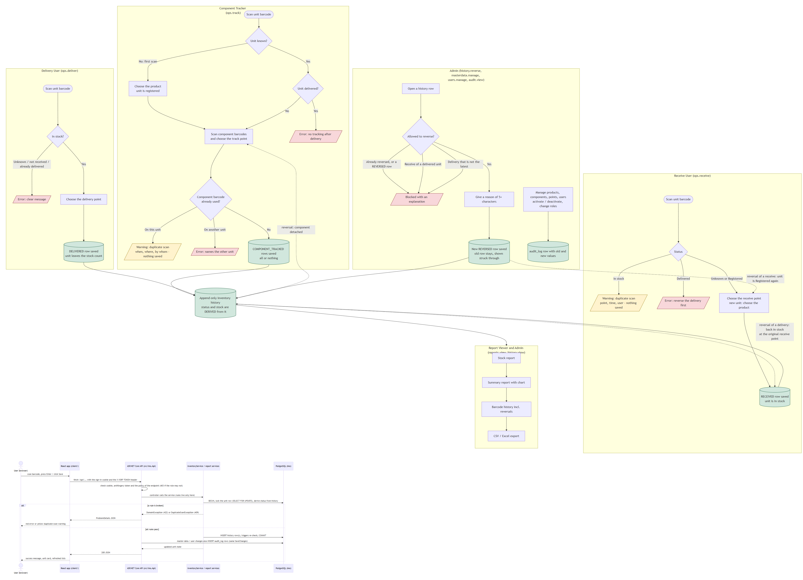
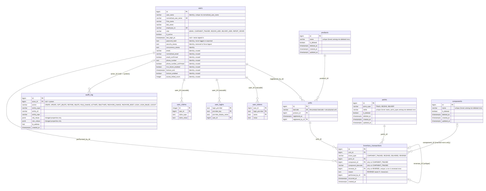
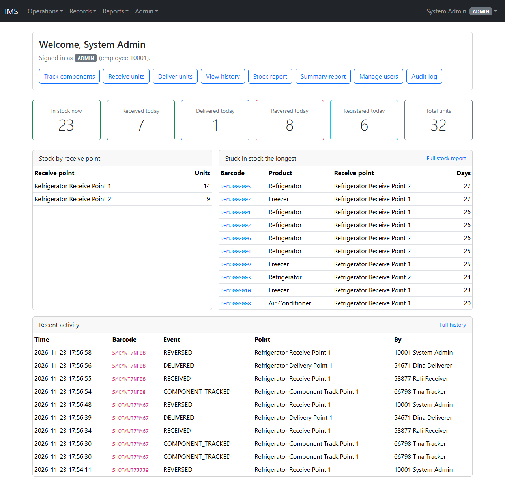
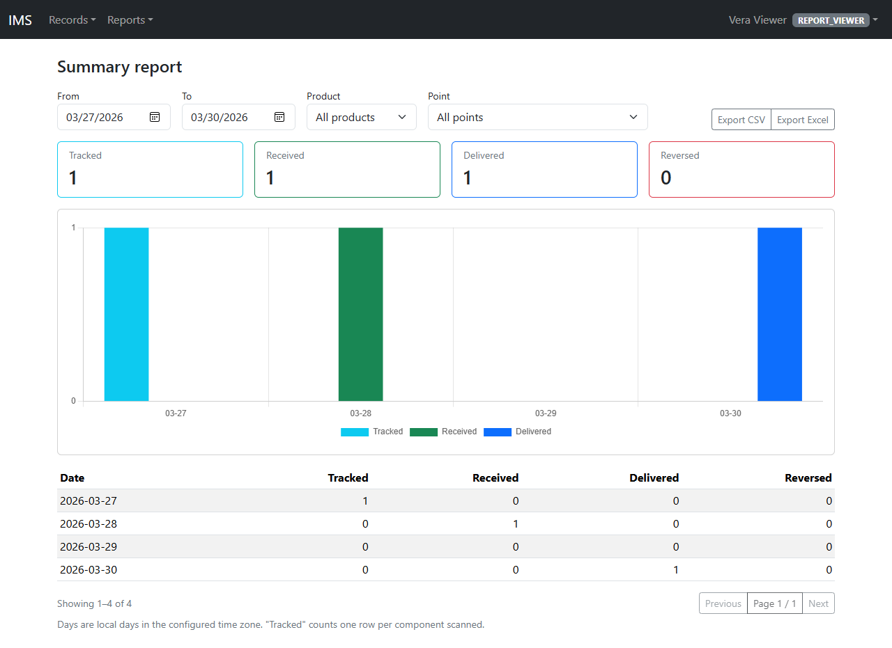
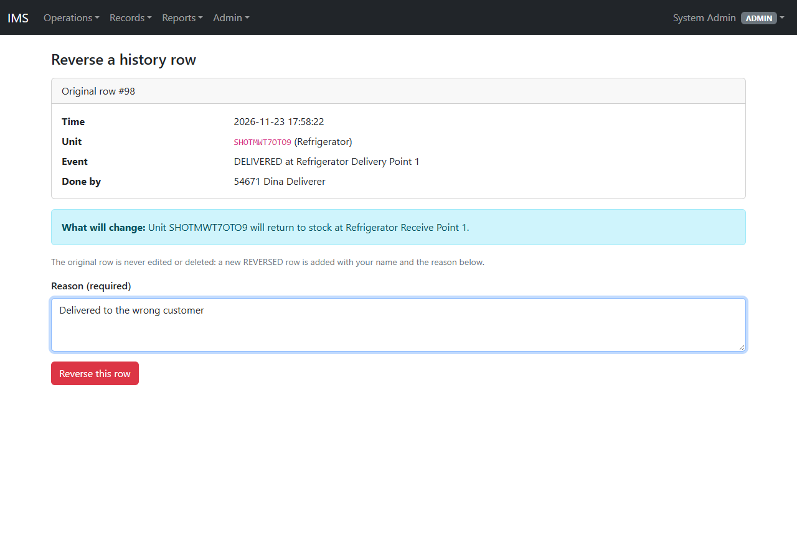

# Inventory Management System

Barcode-based tracking: **components -> receiving -> delivery**

Industrial attachment project, v1.0.0
Rezowan Rahman Raj

---

# The problem

- Factories move **single physical units** (a refrigerator with its own barcode).
- Which **components** are inside? Is the unit **in stock** or **delivered**? **Where**? **Who** did it?
- Mistakes happen: the history must stay **honest** and **correctable**.

**Goal:** a working, presentable end-to-end system, not production hardening.

---

# Five roles, enforced on the server

| Role | Does |
|---|---|
| Component Tracker | scans components onto a unit |
| Receive User | receives units at a receive point |
| Delivery User | delivers units that are in stock |
| Report Viewer | reads history and reports, exports |
| Admin | administration, **reversals**, audit log |

One role per user. 5 roles x every endpoint is covered by an automated policy-matrix test.

---

# Architecture

```
Browser (React 19 + TypeScript)
   |  fetch /api  - cookie + antiforgery header
ASP.NET Core Web API (.NET 10) - policies, InventoryService, EF Core
   |  SQL
PostgreSQL 17
```

- **One origin:** the API also serves the built React app (no CORS).
- **Why:** typed C# and TypeScript end to end, Identity cookie login (no tokens in the browser), real PostgreSQL.

---

# Flow (see `docs/diagrams/process-flow.png`)



Rules shown as diamonds; duplicate scan = warning, broken rule = error.

---

# Data model (see `docs/diagrams/er-diagram.png`)



**No status column:** status and stock are derived from the append-only history.

---

# Key rules

- A unit is registered by its **first scan**; a component belongs to **one unit** at a time.
- Deliver only what is **in stock**; no tracking after delivery.
- History is **append-only**: EF interceptor **and** PostgreSQL triggers.
- **Reversal** (admin, reason >= 5 characters) adds a row: receive only if not delivered, delivery returns to its receive point, component is detached.
- Used master data is **archived**, never erased. Deactivated users are signed out at once.
- **Audit log** with old/new values; no password data.

---

# Screenshots

  

Dashboard - summary chart - reversal. All 35 screens: `docs/user-guide/`.

---

# Testing

- **114** xUnit tests on a real PostgreSQL database (rules R1-R13, policies, triggers, exports, audit)
- **41** Vitest tests (forms, guards, export links, dashboard)
- **7** Playwright end-to-end specs (sample flow, 5-role UI matrix, screenshots)
- **97** executed cases in `docs/testing/test-cases.xlsx`: 96 pass, 1 not run (needs desktop Excel)

---

# What I learned

- C# and .NET: dependency injection, EF Core migrations and interceptors, ASP.NET Core Identity and policies.
- React: hooks, TanStack Query, forms with zod, state in the URL.
- Derive, don't store: one history, many reports.
- Tests that use the real database catch what mocks hide.
- Next: camera scanning, larger data volumes, hosting.

**Thank you - questions?**
