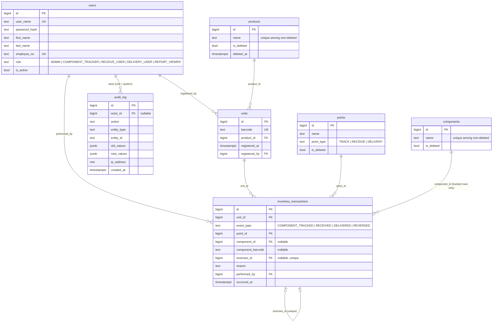

# ER diagram (DRAFT, Day 1)

Matches the EF Core model. Final image version comes on Day 5/6. `inventory_transactions` and `audit_log` are
append-only (EF interceptor + PostgreSQL trigger). There is no status column anywhere: status is derived from history.

