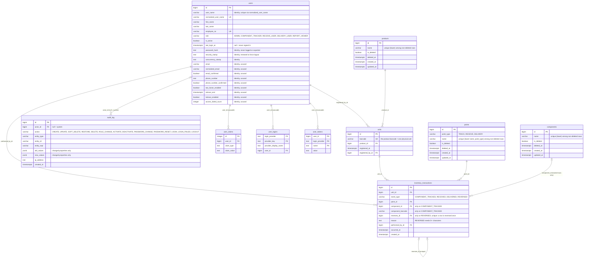

# ER diagram (final, Day 5)

This diagram matches the PostgreSQL schema produced by the EF Core migrations one-to-one (`docs/db/schema.sql`):
same 10 tables, same column names, same keys. Types are written as PostgreSQL types.
Legend: **PK** primary key, **FK** foreign key, **UK** unique (a plain unique index).

## Notes that the diagram cannot show

- **There is no status column.** The status of a unit (Registered, In stock, Delivered) and the stock count are *derived*
  from `inventory_transactions`: take the rows that are not `REVERSED` and not cancelled by a `REVERSED` row, in time order;
  the last `RECEIVED` / `DELIVERED` row decides. Which components are attached is derived the same way.
- **Append-only.** `inventory_transactions` and `audit_log` can only be inserted into. Two layers enforce it: the EF Core
  `AppendOnlyInterceptor`, and the PostgreSQL function `forbid_change()` with `BEFORE UPDATE OR DELETE` triggers
  (`trg_tx_append_only`, `trg_audit_append_only`). A reversal is a **new** row with `event_type = 'REVERSED'` whose
  `reverses_id` points at the cancelled row (the self-reference `inventory_transactions.reverses_id -> id`).
- **More database rules** (CHECK constraints and a trigger): `ck_tx_component_only_on_tracked` (component columns only on
  COMPONENT_TRACKED rows), `ck_tx_reversal_shape` (REVERSED rows need `reverses_id` and a reason of 5+ characters), and the
  trigger `trg_tx_check` (`check_transaction()`): the point type must match the event (TRACK / RECEIVE / DELIVERY), a component
  barcode cannot be attached twice, and a REVERSED row cannot be reversed.
- **Soft delete.** Master data that is already used is not removed: `is_deleted` is set (hidden from dropdowns, still shown in
  history, restorable). The uniqueness of names is a *partial* unique index on `lower(name) WHERE NOT is_deleted`
  (`ux_products_name_active`, `ux_components_name_active`, `ux_points_name_type_active`). Users are never deleted, only
  deactivated (`is_active`).
- **ASP.NET Core Identity** supplies most of the `users` columns (the ones marked "Identity") and the tables `user_claims`,
  `user_logins`, `user_tokens`. The application adds `first_name`, `last_name`, `employee_no`, `role`, `is_active`,
  `last_login_at`. There are no Identity role tables: the role is the `users.role` text column (one role per user).
  The table is named `users` (EF Core renamed it from `AspNetUsers`); only a few auto-generated constraint names still say `asp_net_users`.
- **All foreign keys are `ON DELETE RESTRICT`** except the three Identity child tables (`CASCADE`).
- **All times are `timestamptz`, stored in UTC**; the app shows them in `App:TimeZone` (Asia/Dhaka).
- `__EFMigrationsHistory` (EF Core's bookkeeping table) is not drawn.
