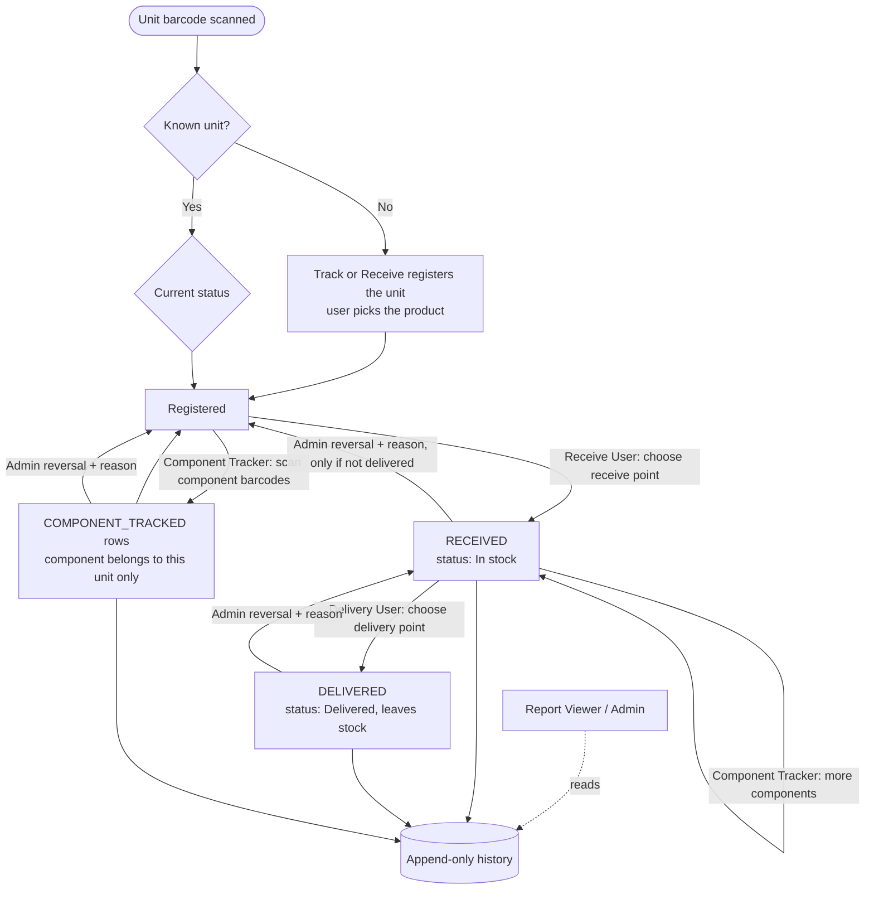

# Process flow (DRAFT, Day 1)

One physical unit, identified by its barcode, moves through three operations. Admin can reverse a step. Final image
version comes on Day 5/6.

Rules: delivered units cannot be received again unless the delivery is reversed; a row can be reversed once; a
reversal row can never be reversed; every reversal is a new `REVERSED` row (nothing is edited or deleted).
