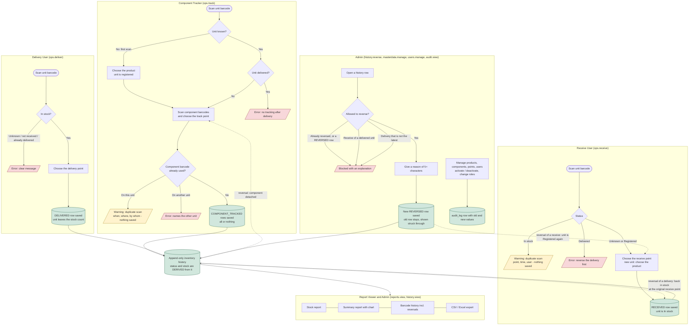
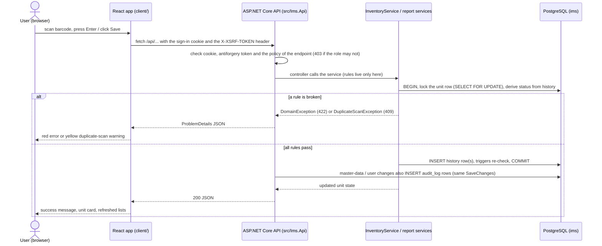

# Process flow (final, Day 5)

One physical unit, identified by its product barcode, goes through **component tracking -> receiving -> delivery**.
Each role works in its own lane; the Admin can reverse a step and the Report Viewer only reads.
Every screen talks to the API in the same way (shown once in the second diagram): **React -> ASP.NET Core API -> PostgreSQL**.

## 1. Business flow by role

Everyone who is signed in can also open the **dashboard** (read-only) and **change their own password**.
A deactivated user is signed out on their very next request.

## 2. What happens on every click: React -> API -> database

Rules shown above: a unit is registered by its first scan; tracking is blocked after delivery; receiving only works for a unit
that is neither in stock nor delivered; delivery only for units in stock; a duplicate scan is a *warning*, a broken rule an
*error*; a row can be reversed once; a `REVERSED` row can never be reversed; nothing is ever edited or deleted.
